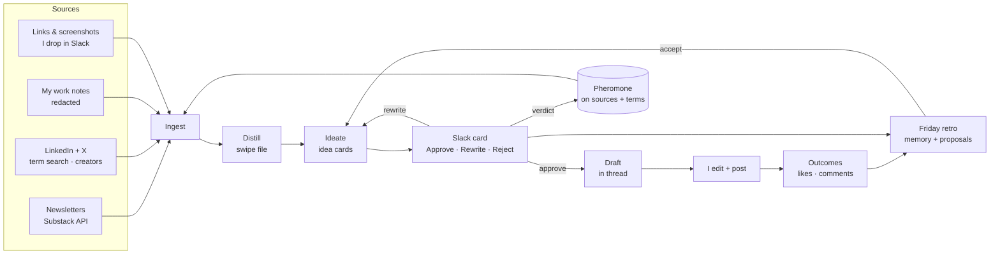

# How content-agents works

A small system that hands me post ideas worth writing, learns from which ones I pick, and goes looking for new
sources on its own. I write and publish everything myself; the system's job is to make sure I never start from a
blank page and that the ideas get better every week.

It runs entirely on free tiers (Trigger.dev, LangSmith, Cloudflare Workers, Substack's public API, Apify's monthly
credit). The only real cost is model calls, roughly $5–10 a month.

## The loop

1. **Ingest.** Every morning it pulls new posts from the newsletters I follow. Twice a week it searches LinkedIn and X
   for a set of terms and pulls recent posts from creators it is following or testing. It also reads my private work
   notes (build sessions, project files, daily captures) with customer names and IDs stripped.
2. **Distill.** A cheap model turns each post into a swipe-file record: the hook as written, a reusable template of
   it, the format, topics, the core claim, and a guess at why it worked. Engagement is measured against the author's
   own norm, so a 40-like post from a small GTM newsletter can outrank a 2,000-like post from a giant one.
3. **Ideate.** Twice a week a stronger model reads the best hooks, my recent work notes, my past posts, and what I
   have approved and rejected, and writes 6–8 idea cards: a title, the opening line, why that hook works, my angle,
   and the posts that inspired it.
4. **Decide in Slack.** Each card is a Slack message with three buttons. Approve writes a first draft into the
   thread. Rewrite asks what to change and regenerates the card on the spot. Reject asks why (optional). Every click
   is scored in LangSmith against the run that produced the card.
5. **Retro.** On Fridays it reads the week's verdicts and how my published posts did, rewrites its own memory of
   what works and what to avoid, and proposes prompt rules and source changes, each with Accept / Skip buttons. It
   never changes its own instructions without a click.

## Foraging: how it finds new sources

Sources and search terms live in a registry with a lifecycle (`candidate → trial → active → paused → retired`) and a
score, borrowed from ant colonies:

- **Pheromone.** A source's score goes up when its posts clear the bar or inspire a card I approve, and down when they
  don't. Scores evaporate a little every week, so trails that stop paying fade on their own.
- **Exploit and explore.** Each run splits its budget with Thompson sampling: most goes to proven sources, a fixed
  share to candidates, and one slot to a uniformly random candidate so nothing is ever unreachable.
- **New trails.** Authors of strong, on-topic, high-engagement posts found by search become candidates. So do
  newsletters linked from strong newsletter posts, and anything I drop into Slack.
- **Keywords from my reading.** Search terms are derived weekly from the topics my newsletters actually write about,
  plus a few I pin. A term keeps its slot until it has enough results to judge, so new terms get a fair test.
- **Hard limits outside the loop.** Exploration share, decay rate, caps, and monthly spend are config only I edit;
  the system can propose changes but not make them.

## Design choices

- **Files as memory.** All state is markdown, YAML, and JSONL in a private git repo. Every change the agents make is a
  commit I can read or revert. DuckDB queries the JSONL directly when a stage needs a ranked view.
- **Public code, private state.** Nothing personal is hardcoded; my sources, notes, cards, and memory live in a
  separate private repo.
- **Humans at every loop.** I am the grader for ideas (verdicts), for drafts (I rewrite), and for the system itself
  (retro proposals). Four loops, borrowed from LangChain's "The Art of Loop Engineering": the agent, verification,
  event-driven triggers, and hill-climbing on its own harness.
- **Cheap where it can be.** Haiku-class extraction at ~$0.0005 per post; the stronger model only for ideas, drafts,
  and the retro.

## Stack

| Piece | Role |
|---|---|
| Trigger.dev | schedules + on-demand tasks (ingest, ideate, verdicts, retro, intake) |
| Cloudflare Worker | Slack buttons, modals, link drops, `/ca` command (3-second Slack deadline) |
| Anthropic API | distill (Haiku), ideate / draft / retro (Opus) |
| LangSmith | traces + verdict feedback on every ideation run |
| Apify | LinkedIn post search, profile posts, X search |
| Substack public API | newsletter posts with likes, comments, restacks |
| GitHub | private state repo; every agent change is a commit |
